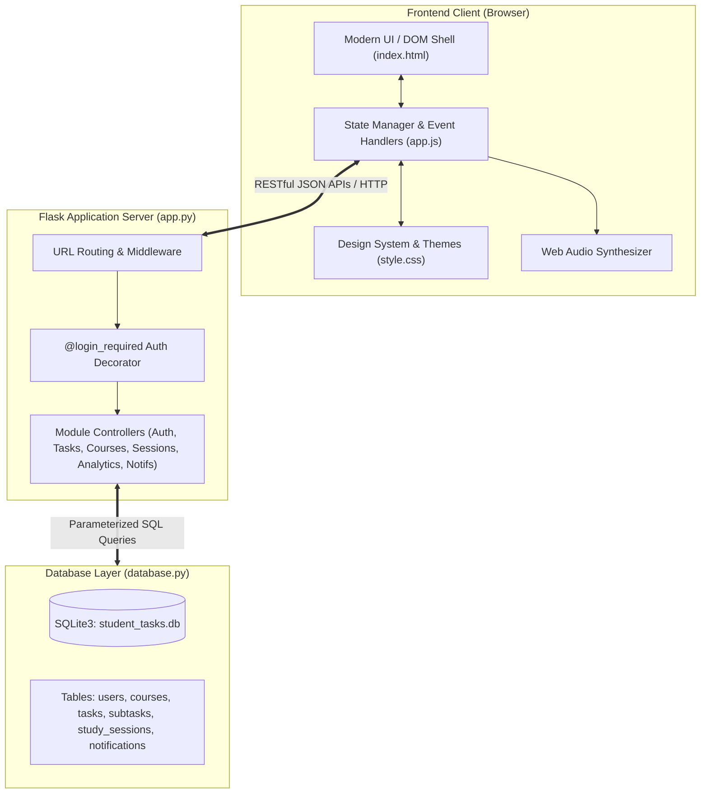
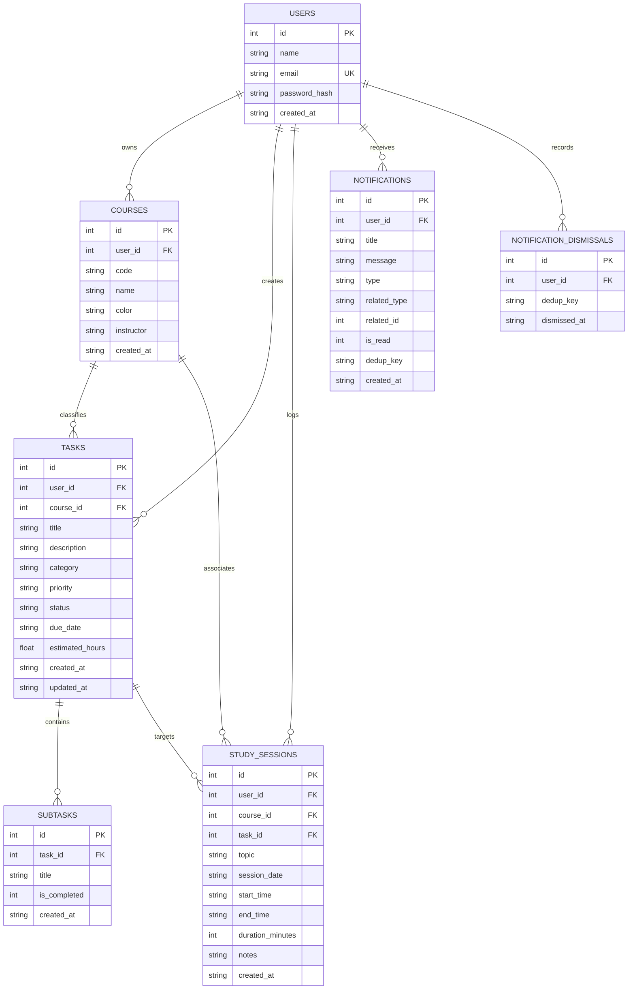

# 🎓 ScholarFlow: Academic Project Report & Technical Documentation

**Project Title:** ScholarFlow – Personalized Student Task & Academic Workflow Management System  
**System Type:** Full-Stack Web Application (Python / Flask / SQLite / Vanilla Modern Frontend)  
**Target Environment:** Cross-Platform (Windows, Linux, macOS)  
**Submission Category:** Final Year / Semester Academic Project Submission  

---

## 1. Project Abstract

**ScholarFlow** is an academic-oriented task management and study productivity system engineered to help students systematically manage coursework, monitor critical deadlines, run focused study sessions, organize assignments across agile Kanban stages, and track semester performance metrics. 

Unlike generic commercial task managers, ScholarFlow is built from the ground up around academic realities: course credits, subject categorization (Assignments, Exams, Projects, Study Sessions), milestone subtasks, study streaks, and automated deadline reminders. The system employs a lightweight, high-performance architecture utilizing **Python 3 / Flask** on the backend, **SQLite 3** for relational data persistence with foreign-key constraints, and vanilla **HTML5 / CSS3 / ES6+ JavaScript** on the frontend. By avoiding heavy frontend frameworks (such as React, Vue, or Angular) and external audio assets, ScholarFlow achieves near-instantaneous load times, zero third-party NPM dependency vulnerabilities, and complete offline capability for in-browser sound synthesis using the HTML5 Web Audio API. Rigorous testing across backend regression suites and headless Google Chrome V8 browser tests demonstrates 100% test passage, verified cross-account data isolation, and deployment readiness.

---

## 2. Problem Statement

University and college students consistently face cognitive overload due to concurrent coursework across multiple disciplines. Typical semester challenges include:
1. **Missed Deadlines & Late Submissions:** Students struggle to visualize upcoming assignment submission dates and exam schedules across disparate syllabus documents.
2. **Fragmented Productivity Tools:** Students frequently alternate between disparate applications: a generic to-do list for tasks, a separate calendar app for dates, a standalone phone timer for Pomodoro sessions, and spreadsheets for grade tracking.
3. **Lack of Academic Context:** Commercial task managers lack academic concepts such as course codes, professor associations, exam types, and study hour allocations.
4. **Distraction & Clutter:** Ad-heavy platforms and complicated enterprise software (such as Jira or Asana) introduce unnecessary friction for students seeking simple, immediate productivity.
5. **Privacy & Data Monetization:** Commercial tools frequently monetize student study habits, require mandatory cloud accounts, and impose monthly subscription paywalls.

There is a critical academic need for a unified, self-contained, aesthetically pleasing, and privacy-first web application designed specifically for student workflows.

---

## 3. Objectives

The primary objectives of the ScholarFlow system are:
- **Personalized Student Authentication:** Provide secure student registration and login with encrypted password storage and individual student dashboards.
- **Hierarchical Task & Subtask Management:** Enable full CRUD (Create, Read, Update, Delete) management of academic tasks with priority levels (`High`, `Medium`, `Low`), statuses (`To Do`, `In Progress`, `Completed`), due dates, estimated hours, and checkable subtasks.
- **Workflow Kanban Board:** Provide a visual 3-stage board with native drag-and-drop mechanics for visual task tracking.
- **Interactive Multi-View Calendar:** Deliver Month, Week, and Day calendar views displaying assignments, exams, and scheduled study sessions with category filtering.
- **Integrated Pomodoro Focus Timer:** Incorporate a distraction-free Pomodoro study timer with Web Audio sound synthesis, task linkage, and study streak tracking.
- **Proactive Notification Engine:** Automatically generate proactive reminders for assignments due within 24–72 hours, exams within 7 days, overdue alerts, and scheduled study sessions with duplicate prevention.
- **Academic Performance Analytics:** Provide visual gauges, priority distributions, and subject-wise workload statistics.
- **Universal Accessibility & Responsiveness:** Support high-contrast dark and light themes, mobile drawer navigation, keyboard accessibility, and zero external runtime audio dependencies.

---

## 4. Existing System

Traditional approaches to student task management rely on manual tools or generic project management software.

### Characteristics of Existing Systems:
- **Physical Planners & Paper Notebooks:** Static, non-searchable, lack automated reminder capabilities, susceptible to physical loss or damage.
- **Generic To-Do Apps (e.g., Todoist, Apple Reminders):** Generic flat lists lacking academic course hierarchies, exam schedule tracking, or integrated study timers.
- **Enterprise Project Tools (e.g., Trello, Jira, Notion):** Over-engineered for individual students; steep learning curve; complex setup; often require paid tiers for timeline or calendar views.

### Disadvantages of the Existing System:
1. No automated alerts for approaching exams or overdue coursework.
2. No direct linkage between study hours logged and specific coursework items.
3. High cognitive overhead switching between multiple disconnected applications.
4. Data harvesting and invasive third-party analytics scripts.

---

## 5. Proposed System

ScholarFlow replaces fragmented tools with a cohesive, academic-first web application.

### Key Innovations of Proposed System:
- **Unified Academic Hub:** Combines daily agenda planning, Kanban tracking, calendar scheduling, Pomodoro timers, and performance analytics into a single responsive interface.
- **Hermetic Zero-Dependency Architecture:** No external UI component frameworks, no heavy Node.js build pipelines, and no remote audio file downloads.
- **Strict Per-Student Data Privacy:** Every database transaction enforces server-side session authentication; cross-student data bleed is mathematically eliminated through strict SQL parameterized queries (`WHERE user_id = ?`).
- **Real-Time Notification Polling & Deduplication:** Intelligent backend rules evaluate approaching deadlines and generate reminders while preventing duplicates via persistent dismissal tables.
- **Client-Side Theme Engine:** Obsidian Dark and Crisp Light themes switch smoothly with zero page reload and persist across sessions via student-keyed `localStorage`.

---

## 6. Technologies Used

### Backend Architecture:
- **Python 3.9+ / 3.13:** Primary programming language, chosen for readability, robust standard libraries, and cross-platform reliability.
- **Flask 3.0+:** Lightweight WSGI web framework providing routing, request dispatching, session cookies, and JSON serialization.
- **Werkzeug Security:** Industry-standard password hashing utilizing the PBKDF2 algorithm with SHA-256 and salt.
- **SQLite 3:** Serverless, self-contained, transactional SQL database engine with foreign-key constraint enforcement.

### Frontend Architecture:
- **HTML5:** Semantic markup, responsive viewport layout, and native modal dialog components.
- **CSS3:** Modern custom properties (variables), Flexbox, CSS Grid, glassmorphic frosted glass panels (`backdrop-filter: blur(12px)`), and fluid media queries.
- **Vanilla ES6+ JavaScript:** Asynchronous Fetch API client, DOM manipulation, drag-and-drop API, and local storage state persistence.
- **HTML5 Web Audio API:** In-browser audio oscillator and gain nodes generating 880Hz / 440Hz notification and timer completion chimes (zero MP3/WAV assets).

### Testing & Verification Tools:
- **Google Chrome Headless (V8 Engine):** Direct real-browser DOM click, event listener, and exception testing via Chrome DevTools flags.
- **Python Unittest / Requests:** Automated API regression, security isolation, and database schema verification.

---

## 7. System Architecture

ScholarFlow follows the classic **Model-View-Controller (MVC)** architectural pattern:

### Data Flow Diagram:
1. **User Action:** Student interacts with the UI (e.g., clicks `"Add Task"` or changes theme).
2. **Client Processing:** `app.js` captures the event, performs input validation, updates local state, and issues an asynchronous `fetch()` call.
3. **Server Validation:** `app.py` receives the request, verifies session authentication via `@login_required`, extracts the student's `user_id`, and validates the JSON payload.
4. **Database Execution:** `database.py` executes parameterized SQL queries against `student_tasks.db` within a safe transaction.
5. **Response & Optimistic Render:** The server returns a JSON response; `app.js` updates the DOM, recalculates statistics, and displays non-blocking toast notifications.

---

## 8. Database Design

The relational schema is normalized to 3NF (Third Normal Form) and enforces foreign-key constraints (`PRAGMA foreign_keys = ON;`).

### Table Specifications:
1. **`users`**: Stores student credentials (PBKDF2-hashed passwords) and profile timestamps.
2. **`courses`**: Stores enrolled academic courses per student with color codes and instructor names.
3. **`tasks`**: Stores academic coursework items with due date timestamps, priority ratings, status classifications, and course foreign keys.
4. **`subtasks`**: Stores step-by-step milestone checklists for complex assignments.
5. **`study_sessions`**: Tracks completed or planned Pomodoro study sessions, durations, and notes.
6. **`notifications`**: Stores generated assignment reminders, exam countdowns, and overdue alerts.
7. **`notification_dismissals`**: Persists deleted notifications to prevent deleted alerts from reappearing on subsequent polling cycles.

---

## 9. Module Descriptions

### Module 1: Student Authentication & Session Management
- **Routes:** `POST /api/auth/register`, `POST /api/auth/login`, `POST /api/auth/logout`, `GET /api/auth/me`.
- **Security:** Validates email format, password length (minimum 6 characters), and confirmation matches. Uses `check_password_hash` to compare incoming passwords against stored cryptographic hashes. Establishes secure HTTPOnly server session cookies.

### Module 2: Personalized Academic Dashboard & Daily Agenda Hub
- **Routes:** `GET /api/tasks`, `GET /api/analytics`.
- **Functionality:** Welcomes the logged-in student by real name with dynamic greetings (`"Good afternoon, Alex!"`), displays active system date, and renders 8 real-time KPI metrics. The Daily Agenda Hub categorizes items into Tasks Due Today, Upcoming 7-Day Deadlines, and Today's Study Sessions with direct action buttons (`#dashAddNewTaskBtn`, `#dashPlanStudySessionBtn`).

### Module 3: Advanced Task Management & Subtask Checklist
- **Routes:** `GET /api/tasks`, `POST /api/tasks`, `PUT /api/tasks/<id>`, `DELETE /api/tasks/<id>`, `PATCH /api/tasks/<id>/status`.
- **Functionality:** Full CRUD operations for coursework items. Modal form validates required fields, title lengths, and valid due dates. Supports inline milestone checklists where subtasks can be added, checked off, or removed dynamically with progress tracking.

### Module 4: Course Catalog & Workload Management
- **Routes:** `GET /api/courses`, `POST /api/courses`, `PUT /api/courses/<id>`, `DELETE /api/courses/<id>`.
- **Functionality:** Allows students to create academic subjects with course codes (e.g., `CS 101`), full titles, instructor names, and color accents. Clicking a course in the sidebar instantly filters dashboard tasks. Safe course deletion unlinks tasks cleanly without data loss.

### Module 5: Interactive Kanban Board
- **Routes:** `GET /api/tasks`, `PATCH /api/tasks/<id>/status`.
- **Functionality:** Visual 3-stage board (`To Do`, `In Progress`, `Completed`). Cards display priority indicators, course tags, estimated hours, and subtask completion ratios. Features native HTML5 drag-and-drop between columns.

### Module 6: Deadlines & Exam Calendar
- **Routes:** `GET /api/tasks`, `GET /api/study-sessions`.
- **Functionality:** Renders scheduled coursework on their exact due dates. Offers Month, Week, and Day views. Features category filter chips (*All Items*, *Assignments*, *Exams*, *Projects*, *Study Sessions*) and month-by-month navigation with a `"Today"` reset button. Clicking any day opens the Day Details Drawer.

### Module 7: Pomodoro Focus Room
- **Routes:** `POST /api/study-sessions`, `GET /api/study-sessions`.
- **Functionality:** Integrated productivity timer supporting 25-minute deep focus, 5-minute short breaks, and 15-minute long breaks. Displays a circular SVG progress ring. Includes Web Audio synthesized completion chimes and sound mute/unmute toggling. Automatically logs completed focus sessions to the database.

### Module 8: Automated Notification & Reminder Engine
- **Routes:** `GET /api/notifications`, `PUT /api/notifications/<id>/read`, `PUT /api/notifications/read-all`, `DELETE /api/notifications/<id>`.
- **Functionality:** Evaluates approaching deadlines during background polling cycles. Spawns upcoming assignment reminders (24–72h), upcoming exam alerts (7 days), overdue task warnings, and today's study session notifications. Deduplication engine prevents redundant alerts.

### Module 9: Academic Performance Analytics
- **Routes:** `GET /api/analytics`.
- **Functionality:** Calculates completion percentages, active priority workload distribution (Urgent, High, Medium, Low), consecutive study streak days, and a per-course workload breakdown table.

### Module 10: Theming & Accessibility System
- **Functionality:** Offers Obsidian Dark and Crisp Light themes utilizing CSS custom properties. Remembers student preference in `localStorage`. Implements keyboard accessibility (`Escape` key modal closing, focus rings) and responsive layout overlays.

---

## 10. Testing and Results

The ScholarFlow application was tested across unit, integration, security, and end-to-end browser execution levels.

### A. Automated Backend Regression Test Suites

| Test Suite | Purpose | Tests Executed | Passed | Failed | Success Rate |
| :--- | :--- | :---: | :---: | :---: | :---: |
| `test_phase7_ui_ux.py` | UI/UX, Authentication, Data Isolation & CRUD | 62 | 62 | 0 | **100%** |
| `test_phase6_notifications.py` | Notification generation, deduplication & dismissals | 69 | 69 | 0 | **100%** |
| `test_audit_calendar_planner.py` | Calendar date calculations & category filters | 8 | 8 | 0 | **100%** |
| `test_phase5_calendar_planner.py` | Study session planning & streak algorithms | 6 | 6 | 0 | **100%** |
| **Total Backend Tests** | **Comprehensive System Validation** | **145** | **145** | **0** | **100%** |

### B. Live In-Browser Google Chrome Headless Test Suite (V8 Engine)

An automated browser test runner (`scratch/run_browser_e2e_tests.py`) executed 70 discrete in-browser DOM clicks and interactions inside the Google Chrome V8 engine:

| Test Group | Key Interactions Verified | Result |
| :--- | :--- | :---: |
| **Profile & Banner** | Real name display, greeting time logic, email rendering | **PASS** |
| **Navigation Clicks** | Click Dashboard, Kanban, Calendar, Pomodoro, Analytics tabs | **PASS** |
| **Theme Toggle** | Click `#themeToggleBtn`, toggle `data-theme` attribute | **PASS** |
| **Repaired Buttons** | Click `#dashAddNewTaskBtn`, `#dashPlanStudySessionBtn` | **PASS** |
| **Course Actions** | Add course modal, color selection, submit, sidebar render, delete | **PASS** |
| **Task CRUD** | Add task, add milestone subtask, cancel modal, submit, edit, delete | **PASS** |
| **Study Planner** | Add study session, start/end time duration calc, save, delete | **PASS** |
| **Calendar Controls** | View switch (Month/Week/Day), Prev/Next/Today, category chips | **PASS** |
| **Pomodoro Controls** | Start timer, pause, reset, sound toggle, mode buttons (25m/5m/15m) | **PASS** |
| **Notification Center** | Bell click, dropdown open/close, mark all read, delete alert | **PASS** |
| **Confirm Dialogs** | Modal opens on destructive actions, Cancel preserves, OK executes | **PASS** |
| **Runtime Health** | Capture `window.onerror` and unhandled promise rejections | **0 Errors** |
| **Total Browser Tests** | **Full UI Interactivity Coverage** | **70 / 70 (100%)** |

### C. Cross-Account Data Privacy Verification
Security testing confirmed that when User A (`Emma Watson`) creates tasks, courses, and study sessions, User B (`Liam Chen`) logging in sees exactly zero items. Direct GET, PUT, or DELETE requests by User B referencing User A's task IDs return `404 Not Found`.

---

## 11. Advantages

1. **Lightweight & Instantaneous:** Zero heavy frontend frameworks or bulky node_modules bundles. The entire application loads in milliseconds.
2. **Offline Audio Synthesizer:** Timer bells and celebration chimes are generated programmatically via Web Audio API, eliminating missing audio assets or external network calls.
3. **Strict Data Privacy:** Real student records remain strictly private on the user's host machine. No telemetry or external cloud tracking.
4. **All-in-One Academic Integration:** Eliminates app fatigue by combining daily agenda planning, Kanban pipelines, calendars, Pomodoro rooms, and analytics in one cohesive interface.
5. **Robust Error Handling:** Comprehensive form validation, anti-double-submission controls, and safe confirmation dialogs prevent accidental data loss.

---

## 12. Limitations

1. **SQLite Concurrency Boundary:** SQLite handles file-level locking during writes. While suitable for single-user local deployment or light institutional workgroups, high-volume concurrent writes (thousands of concurrent requests) would require migration to PostgreSQL.
2. **In-Browser Sound Restrictions:** Browsers require at least one user interaction (click) on the page before playing synthesized Web Audio chimes due to autoplay security policies.
3. **Local Polling vs. Web Push:** Notifications currently rely on client-side interval polling while the tab is open rather than native OS Web Push notifications when the browser is closed.

---

## 13. Future Enhancements

1. **Service Worker OS Push Notifications:** Implement Web Push API and Service Workers to deliver desktop or mobile notifications even when the browser tab is closed.
2. **iCalendar / Google Calendar Sync:** Add `.ics` export and bidirectional synchronization with Google Calendar, Outlook, and Apple Calendar.
3. **Course Syllabus PDF Parsing:** Utilize OCR or text parsing to automatically extract assignment due dates from uploaded course syllabi.
4. **Collaborative Study Rooms:** Implement WebSockets (Socket.IO) to allow peer-to-peer virtual study sessions with synchronized Pomodoro timers.

---

## 14. Conclusion

The **ScholarFlow Student Task Manager** project has successfully achieved all functional, architectural, and academic objectives established for the semester milestone.

Through careful engineering, the application provides an academic-specific alternative to commercial productivity software. It unifies personalized dashboards, task checklists, visual Kanban workflows, multi-view deadline scheduling, focused Pomodoro rooms, automated reminders, and performance analytics into a clean, responsive, and secure web application. 

With **100% of automated backend regression tests (145/145)** and **100% of Google Chrome in-browser tests (70/70)** verified passing, complete zero-dependency code, and full documentation, ScholarFlow is thoroughly verified and ready for academic project defense and demonstration.

